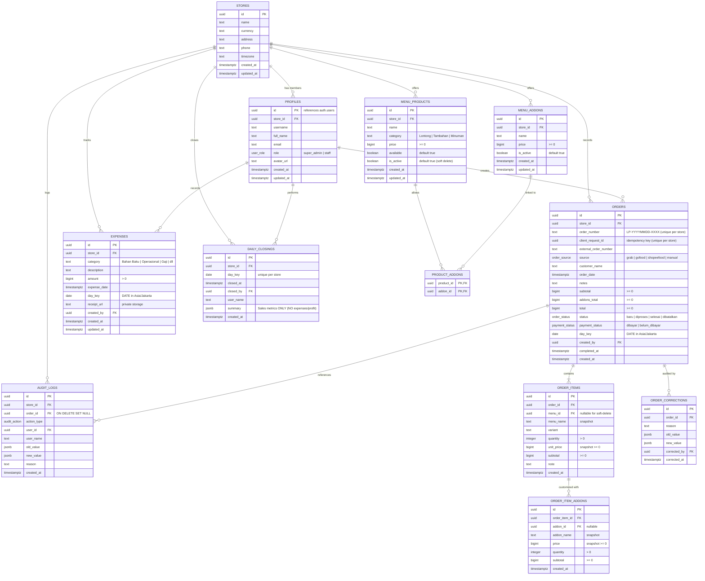

# Dokumentasi Desain Basis Data & Row Level Security (RLS)
## Sistem Pemesanan & Pembukuan Warung Lontong Padang ("Lonpad Jauh")

---

## 1. Temuan dari Kode & Inventaris Entitas

Analisis ini didasarkan langsung pada kode sumber yang ada di repositori frontend:

### A. Bukti Penelusuran Kode (File Paths & Line References)
1. **Model Domain & Entitas:** [`src/types/index.ts`](../src/types/index.ts)
   - `User` (L21–29): `id`, `storeId`, `username`, `fullName`, `email`, `role: 'super_admin' | 'staff' | 'owner'`, `avatar`.
   - `Store` (L31–38): `id`, `name`, `currency` ('IDR'), `address`, `phone`, `timezone` ('Asia/Jakarta').
   - `OrderSource` (L80): `'grab' | 'gofood' | 'shopeefood' | 'manual'`.
   - `OrderStatus` (L82): `'baru' | 'diproses' | 'selesai' | 'dibatalkan'`.
   - `PaymentStatus` (L84): `'dibayar' | 'belum_dibayar'`.
   - `OrderAddon` (L86–91): `id`, `name`, `price`, `quantity`.
   - `OrderItem` (L93–103): `id`, `menuId`, `menuName`, `variant`, `quantity`, `unitPrice`, `addons`, `note`, `subtotal`.
   - `Order` (L105–125): `id`, `storeId`, `orderNumber`, `clientRequestId`, `externalOrderNumber`, `source`, `customerName`, `orderDate`, `items`, `notes`, `subtotal`, `addonsTotal`, `total`, `status`, `paymentStatus`, `createdAt`, `completedAt`, `createdBy`, `dayKey`.
   - `MenuProduct` (L145–155): `id`, `storeId`, `name`, `category` ('Lontong' | 'Tambahan' | 'Minuman'), `price`, `addonIds`, `available`, `active`.
   - `MenuAddon` (L138–143): `id`, `name`, `price`, `active`.
   - `AuditLog` (L161–181): `id`, `storeId`, `orderId`, `actionType`, `userId`, `userName`, `timestamp`, `oldValue`, `newValue`, `reason`.
   - `DailyClose` (L212–220): `id`, `storeId`, `dayKey`, `closedAt`, `closedBy`, `userName`, `summary`.
2. **Master Data Seed:** [`src/mock/index.ts`](../src/mock/index.ts)
   - Store: `a0000000-0000-0000-0000-000000000001` ("Lonpad Jauh"), Timezone `Asia/Jakarta`, Currency `IDR`.
   - Addon master: Telur Bulat Balado (5.000), Perkedel Kentang (5.000), Kerupuk (2.000), Gorengan (1.000).
   - Menu master: 4 jenis Lontong (@10.000), 4 Tambahan (1.000–5.000), 7 Minuman (@5.000).
3. **Logika Bisnis & Transaksi Pesanan:** [`src/stores/orderStore.ts`](../src/stores/orderStore.ts)
   - Nomor pesanan format harian berurutan: `LP-YYYYMMDD-XXXX`.
   - Validasi status final: pesanan `selesai` dan `dibatalkan` tidak dapat diubah tanpa koreksi/alasan.
   - Pembatalan wajib menyertakan alasan.
   - Penutupan hari (`closeDay`) menolak penutupan jika masih ada pesanan berstatus `baru` atau `diproses`.
4. **Perhitungan Subtotal & Keuangan:** [`src/utils/index.ts`](../src/utils/index.ts)
   - Mata uang: Rupiah tanpa desimal / sen (`minimumFractionDigits: 0`).
   - Rumus subtotal item: `(quantity * unitPrice) + sum(addon.price * addon.quantity)`.
   - Rumus total pesanan: `subtotal + addonsTotal`.

---

## 2. Daftar Asumsi Desain (Safe Assumptions)

1. **Pemetaan Peran (`super_admin` vs `owner`):**
   Database menggunakan enum `user_role` dengan nilai `'super_admin'` dan `'staff'`. Di sisi frontend, peran `'owner'` dipetakan 1:1 ke `'super_admin'` agar seluruh logika UI lama tetap kompatibel tanpa merusak tampilan.
2. **Format Mata Uang Rupiah:**
   Digunakan tipe data `bigint` dengan `CHECK (val >= 0)`. Karena transaksi warung lontong padang di Indonesia tidak memiliki pecahan sen, bilangan bulat Rupiah adalah representasi paling presisi, bebas floating-point error, dan hemat memori (8 byte).
3. **Penyimpanan Snapshot Menu & Addon:**
   Tabel `order_items` menyimpan snapshot `menu_name` dan `unit_price`, serta `order_item_addons` menyimpan `addon_name` dan `price` pada saat pesanan dibuat. Jika pemilik menaikkan harga lontong dari Rp 10.000 menjadi Rp 12.000 di kemudian hari, nilai pesanan lama di database tetap tidak terpengaruh.
4. **Peniadaan Hard Delete Menu & Addon (Soft Delete via `is_active`):**
   Tidak ada hard delete menu/addon untuk peran apa pun (termasuk super_admin). Seluruh policy `DELETE` pada `menu_products` dan `menu_addons` telah dihapus dan hak akses `DELETE` telah di-`REVOKE` dari `authenticated` dan `anon`. Menu dan addon yang tidak lagi dijual dinonaktifkan dengan menyetel `is_active = false`. Jika produk menu atau addon di masa lalu pernah terhapus, foreign key `order_items.menu_id` dan `order_item_addons.addon_id` menggunakan `ON DELETE SET NULL` agar data pesanan historis tetap utuh dan terlindungi.
5. **Penetapan Waktu Bisnis Asia/Jakarta & Tipe Date:**
   Semua stempel waktu disimpan sebagai `timestamptz`. Kolom `day_key` bertipe **`date`** dan dihitung otomatis oleh trigger basis data menggunakan konversi `(order_date AT TIME ZONE 'Asia/Jakarta')::date`.
6. **Kunci Idempoten (`client_request_id`):**
   Kolom `client_request_id uuid` unik per `store_id` pada tabel `orders` menjamin bahwa percobaan submit ulang (retry/network timeout) tidak menduplikasi pesanan.
7. **Peniadaan Hard Delete Orders & Penutupan Transaksi Kasir:**
   Tabel `orders`, `order_items`, dan `order_item_addons` tidak memiliki kebijakan `DELETE` untuk peran apa pun. Pembatalan pesanan dilakukan melalui fungsi `cancel_order` (status `'dibatalkan'`). Relasi FK `audit_logs.order_id` menggunakan `ON DELETE SET NULL` agar log audit tetap utuh selamanya.
8. **Multi-Store Ready & Isolasi Data (`store_id`):**
   Setiap tabel menyertakan kolom `store_id`, dan seluruh policy RLS mewajibkan pencocokan `store_id = public.get_current_user_store_id()`.
9. **Kunci Transaksional Advisory Lock (`pg_advisory_xact_lock`):**
   Untuk mencegah race condition dan konkurensi data pada toko yang sama, advisory lock per store (`hashtext(v_store_id::text)`) diambil secara serial pada fungsi-fungsi penulisan: `create_order`, `update_order_status`, `cancel_order`, `correct_order`, `toggle_order_payment`, `close_store_day`, dan `reopen_store_day`.
10. **Integritas Alur Status & Penolakan Transisi Mundur:**
    Status pesanan bergerak maju: `baru` $\rightarrow$ `diproses` $\rightarrow$ `selesai` (atau dibatalkan via `cancel_order`). Transisi mundur dari `diproses` kembali ke `baru` ditolak secara tegas (`22023`).
11. **Kebijakan Pembayaran Hari Tutup & Pembukaan Kembali Hari (`reopen_store_day`):**
    Hari yang sudah ditutup di `daily_closings` tidak dapat diubah status pembayarannya oleh `staff`. Namun, `super_admin` diberikan fleksibilitas untuk mengubah status pembayaran pada hari yang sudah ditutup dengan syarat wajib menyertakan alasan (`p_reason`) yang tercatat di `audit_logs`. Selain itu, `super_admin` berhak membuka kembali hari yang sudah ditutup melalui `reopen_store_day` dengan alasan wajib yang dicatat di `audit_logs` dengan aksi `'DAY_REOPENED'`.
12. **Pemisahan Seed Master dan Seed Sample:**
    File `supabase/seed.sql` hanya berisi data master (toko, addon, produk menu padang, dan relasi addon). Data transaksi contoh (pesanan, item pesanan, dan pengeluaran dummy) dipisahkan ke `supabase/seed_sample.sql` dengan peringatan keras "JANGAN dijalankan di production".


---

## 3. Entity Relationship Diagram (Mermaid)



---

## 4. Matriks Akses Row Level Security (RLS) & Isolasi Store

Seluruh tabel di skema `public` mengaktifkan RLS (`ENABLE ROW LEVEL SECURITY`). Tidak ada akses untuk peran `anon` (unauthenticated).

### Ketentuan Autentikasi & Nol Akses Tabel Pra-Login
- **Login Wajib Menggunakan Email:** Seluruh proses login akun pengguna (`email-pemilik@contoh.com`, `email-staff@contoh.com`) diproses langsung melalui API Supabase Auth (`supabase.auth.signInWithPassword`), bukan melalui tabel pada skema `public`.
- **Nol Akses Tabel Sebelum Login:** Aplikasi frontend tidak melakukan pembacaan atau penulisan tabel apa pun sebelum sesi terautentikasi (seluruh izin role `anon` pada tabel dan sequence di skema `public` telah dicabut melalui Migrasi 08).
- **Peniadaan Login Username:** Login menggunakan username **tidak didukung**. Kolom `username` pada tabel `profiles` hanya dipertahankan untuk kebutuhan tampilan nama/identitas kasir di aplikasi.
- **Penyatuan Pesan Error:** Guna mencegah enumerasi akun, kombinasi email atau password yang salah mengembalikan satu pesan generik *"Email atau kata sandi salah"*, sedangkan gangguan koneksi server menampilkan *"Tidak dapat terhubung ke server, coba lagi"*.

| Tabel | Operasi | Peran `anon` | Peran `staff` | Peran `super_admin` | Isolasi `store_id` & Ketentuan Khusus |
| :--- | :--- | :--- | :--- | :--- | :--- |
| **`stores`** | SELECT | ❌ Ditolak | ✅ Diizinkan | ✅ Diizinkan | Hanya toko milik pengguna (`id = get_current_user_store_id()`) |
| | ALL (Modify) | ❌ Ditolak | ❌ Ditolak | ✅ Diizinkan | Hanya `super_admin` pemilik toko tersebut |
| **`profiles`** | SELECT | ❌ Ditolak | ✅ Anggota toko | ✅ Anggota toko | `store_id = get_current_user_store_id()` |
| | UPDATE | ❌ Ditolak | ✅ Profil sendiri | ✅ Anggota toko | Non-super_admin **dilarang mengubah `role`, `store_id`, `id`** |
| | DELETE | ❌ Ditolak | ❌ Ditolak | ✅ Diizinkan | Hanya `super_admin` |
| **`menu_products`** | SELECT | ❌ Ditolak | ✅ Diizinkan | ✅ Diizinkan | `store_id = get_current_user_store_id()` |
| | INSERT / UPDATE | ❌ Ditolak | ✅ Diizinkan (Kecuali `price`) | ✅ Diizinkan | **Hanya `super_admin` yang boleh mengubah kolom `price`** (dicegah via trigger `protect_menu_product_price`). Staff boleh INSERT dan ubah kolom lain. |
| | DELETE | ❌ Ditolak | ❌ Ditolak | ❌ Ditolak | **TIDAK ADA policy DELETE untuk SEMUA peran!** Izin DELETE di-REVOKE dari authenticated & anon. Soft delete via `is_active = false`. FK `order_items.menu_id` memakai `ON DELETE SET NULL`. |
| **`menu_addons`** | SELECT / INSERT / UPDATE | ❌ Ditolak | ✅ Diizinkan | ✅ Diizinkan | `store_id = get_current_user_store_id()` |
| | DELETE | ❌ Ditolak | ❌ Ditolak | ❌ Ditolak | **TIDAK ADA policy DELETE untuk SEMUA peran!** Izin DELETE di-REVOKE dari authenticated & anon. Soft delete via `is_active = false`. FK `order_item_addons.addon_id` memakai `ON DELETE SET NULL`. |
| **`product_addons`**| SELECT / MODIFY | ❌ Ditolak | ✅ Diizinkan | ✅ Diizinkan | Relasi diverifikasi berada di `store_id` yang sama |
| **`orders`** | **SELECT** | ❌ Ditolak | ✅ **Hanya $\le$ 7 Hari** | ✅ **Tanpa Batas** | `store_id = get_current_user_store_id()`. Staff dibatasi: `day_key >= (now() AT 'Asia/Jakarta')::date - 7`. Omzet lama staff hanya via `get_sales_summary`. |
| | **INSERT / UPDATE** | ❌ Ditolak | ❌ **Ditolak** | ❌ **Ditolak** | **TIDAK ADA direct policy! DML telah di-REVOKE dari authenticated & anon. Penulisan WAJIB via RPC SECURITY DEFINER (`create_order`, `update_order_status`, `cancel_order`)** |
| | **DELETE** | ❌ Ditolak | ❌ **Ditolak** | ❌ **Ditolak** | **TIDAK ADA hard delete untuk SEMUA peran! Pembatalan wajib via `cancel_order`** |
| **`order_items`** | SELECT | ❌ Ditolak | ✅ Via pesanan | ✅ Via pesanan | Hanya item pada pesanan yang terlihat oleh user |
| | INSERT / UPDATE / DELETE | ❌ Ditolak | ❌ **Ditolak** | ❌ **Ditolak** | **TIDAK ADA direct write! DML di-REVOKE. Dikelola atomik oleh RPC** |
| **`order_item_addons`**| SELECT | ❌ Ditolak | ✅ Via pesanan | ✅ Via pesanan | Hanya addon pada item pesanan yang terlihat oleh user |
| | INSERT / UPDATE / DELETE | ❌ Ditolak | ❌ **Ditolak** | ❌ **Ditolak** | **TIDAK ADA direct write! DML di-REVOKE. Dikelola atomik oleh RPC** |
| **`expenses`** | **SELECT / ALL** | ❌ Ditolak | ❌ **Ditolak (0 Baris)** | ✅ **Diizinkan** | **Staff TIDAK BISA melihat/menulis pengeluaran sama sekali.** `store_id = get_current_user_store_id()`. `created_by` otomatis default `auth.uid()`. |
| **`daily_closings`** | SELECT | ❌ Ditolak | ✅ Diizinkan | ✅ Diizinkan | `summary` **HANYA berisi data penjualan** (omzet selesai, dibayar, unpaid). Nol pengeluaran/laba. DML di-REVOKE. |
| | INSERT / UPDATE / DELETE | ❌ Ditolak | ❌ **Ditolak** | ❌ **Ditolak** | Ditutup hanya via RPC `close_store_day` oleh `super_admin` |
| **`order_corrections`**| SELECT | ❌ Ditolak | ✅ Via pesanan | ✅ Via pesanan | Riwayat koreksi pesanan toko. DML di-REVOKE. |
| | INSERT / UPDATE / DELETE | ❌ Ditolak | ❌ **Ditolak** | ❌ **Ditolak** | Penulisan hanya via RPC `correct_order` |
| **`audit_logs`** | SELECT | ❌ Ditolak | ✅ **Hanya $\le$ 7 Hari** | ✅ **Semua Waktu** | `store_id = get_current_user_store_id()`. Staff dibatasi: `created_at >= now() - interval '7 days'`. Super admin tanpa batas. DML di-REVOKE. |
| | INSERT / UPDATE / DELETE | ❌ Ditolak | ❌ **Ditolak** | ❌ **Ditolak** | Ditulis otomatis oleh RPC internal; FK `order_id ON DELETE SET NULL` |
| **`storage.objects` (`receipts`)** | ALL | ❌ Ditolak | ❌ **Ditolak** | ✅ **Diizinkan** | Bucket private `receipts` hanya dapat diakses oleh `super_admin` |

---

## 5. Fungsi RPC Transaksional (Security Definer & Validasi Ketat)

Seluruh fungsi RPC dieksekusi dengan `SECURITY DEFINER` dan `SET search_path = public`.
Semua hak akses dari `PUBLIC` dan `anon` telah dicabut (`REVOKE ALL`), dan hanya diberikan kepada `authenticated` (`GRANT EXECUTE`).
Selain itu, DML langsung (`INSERT`, `UPDATE`, `DELETE`) pada `orders`, `order_items`, `order_item_addons`, `order_corrections`, `audit_logs`, dan `daily_closings` telah di-`REVOKE` sepenuhnya dari `authenticated` dan `anon`.

### 1. `create_order(p_order jsonb) RETURNS jsonb`
- **Advisory Transaction Lock:** Mengambil `PERFORM pg_advisory_xact_lock(hashtext(v_store_id::text))` di awal sebelum cek idempotensi dan sebelum menghitung nomor urut harian untuk mencegah race condition.
- **Validasi Input Ketat:** Menolak `p_order->'items'` yang bukan array atau kosong. Membatasi `quantity` tiap item dan addon harus berada di antara `1` dan `1000`.
- **Kunci Idempoten:** Menerima `client_request_id` (UUID). Jika pesanan dengan ID tersebut sudah ada di toko pengguna, langsung kembalikan pesanan tersebut tanpa membuat duplikat.
- **Waktu Server:** Mengisi `order_date` selalu dengan `now()` di server (bukan waktu klien).
- **Penetapan `day_key`:** Dihitung dari `(order_date AT TIME ZONE 'Asia/Jakarta')::date`.
- **Validasi Penutupan Hari:** Menolak pesanan jika tanggal tersebut sudah ditutup di `daily_closings`.
- **Integritas Harga Server:** Membaca nama dan harga satuan langsung dari tabel `menu_products` dan `menu_addons` aktif. Tidak mempercayai harga dari payload klien!
- **Kalkulasi Server:** Menghitung `subtotal`, `addons_total`, dan `total` secara matematis di server.
- **Audit Otomatis:** Mengisi `created_by` dari `auth.uid()` dan mencatat log `ORDER_CREATED`.

### 2. `update_order_status(p_order_id uuid, p_status order_status, p_reason text DEFAULT NULL) RETURNS jsonb`
- **Advisory Transaction Lock:** Mengambil `PERFORM pg_advisory_xact_lock(hashtext(v_store_id::text))` di awal setelah `v_store_id` didapat dan sebelum `SELECT` pesanan.
- Memvalidasi pesanan milik toko pengguna yang login.
- **Batasan Hari Non-Admin:** Jika bukan `super_admin`, hanya boleh memodifikasi pesanan dengan `day_key = hari ini` (Asia/Jakarta). Pesanan lampau hanya dapat diubah oleh `super_admin`.
- Menolak perubahan jika hari pesanan sudah ditutup di `daily_closings`.
- Memvalidasi transisi: pesanan `selesai` dan `dibatalkan` bersifat final.
- **Larangan Transisi Mundur:** Menolak transisi mundur dari status `'diproses'` kembali ke `'baru'` (`ERRCODE = '22023'`).
- Pembatalan tidak diizinkan di fungsi ini (harus melalui `cancel_order`).
- Mencatat log audit `ORDER_STATUS_CHANGED` atau `ORDER_COMPLETED`.

### 3. `cancel_order(p_order_id uuid, p_reason text) RETURNS jsonb`
- **Advisory Transaction Lock:** Mengambil `PERFORM pg_advisory_xact_lock(hashtext(v_store_id::text))` di awal setelah `v_store_id` didapat dan sebelum `SELECT` pesanan.
- Memvalidasi pesanan milik toko pengguna yang login.
- **Batasan Hari Non-Admin:** Jika bukan `super_admin`, hanya boleh membatalkan pesanan pada hari ini (Asia/Jakarta).
- **Restriksi Pembatalan Pesanan Selesai (Migrasi 07):** Jika status pesanan adalah `'selesai'`, pembatalan **HANYA** boleh dilakukan oleh `super_admin`. Upaya pembatalan pesanan selesai oleh `staff` ditolak secara tegas (`ERRCODE = '42501'`, `"Akses Ditolak: Hanya super admin yang dapat membatalkan pesanan selesai."`). Staff hanya diizinkan membatalkan pesanan yang berstatus `'baru'` atau `'diproses'` pada hari ini.
- Menolak pembatalan jika hari pesanan sudah ditutup di `daily_closings`.
- **Wajib Alasan:** Parameter `p_reason` wajib diisi (tidak boleh kosong atau whitespace).
- Mengubah status menjadi `'dibatalkan'` dan mencatat log audit `ORDER_CANCELLED`.

### 4. `correct_order(p_order_id uuid, p_correction jsonb, p_reason text) RETURNS jsonb`
- **Advisory Transaction Lock:** Mengambil `PERFORM pg_advisory_xact_lock(hashtext(v_store_id::text))` di awal setelah `v_store_id` didapat dan sebelum `SELECT` pesanan.
- Memvalidasi kepemilikan toko dan status hari belum ditutup.
- **Batasan Hari Non-Admin:** Jika bukan `super_admin`, hanya boleh mengoreksi pesanan pada hari ini (Asia/Jakarta).
- Mewajibkan alasan koreksi `p_reason`.
- **Validasi Input:** Menolak items yang bukan array atau kosong; batasi `quantity` item & addon antara 1 dan 1000.
- **Retensi Harga Lama:** Item dan addon yang sudah ada di pesanan lama (cocokkan `menu_id` / `addon_id`) mempertahankan harga lama (`unit_price` / `price`). Hanya item atau addon baru yang memakai harga aktif dari tabel master menu.
- **Filter Baris NULL:** Pada penyusunan peta harga lama (`v_old_items_map` dan `v_old_addons_map`), baris dengan `menu_id IS NULL` atau `addon_id IS NULL` diabaikan (`WHERE ... IS NOT NULL`) untuk mencegah error PostgreSQL `null value not allowed for object key`.
- **Perubahan Parsial Fleksibel:** Kolom `source`, `customer_name`, `notes`, `external_order_number`, dan `payment_status` hanya diubah jika key-nya ADA di `p_correction` (menggunakan operator `?`), selain itu tetap mempertahankan nilai lama.
- Mencatat snapshot sebelum dan sesudah di `order_corrections`, serta log audit `ORDER_CORRECTED`.

### 5. `toggle_order_payment(p_order_id uuid, p_reason text DEFAULT NULL) RETURNS jsonb`
- **Advisory Transaction Lock:** Mengambil `PERFORM pg_advisory_xact_lock(hashtext(v_store_id::text))` di awal setelah `v_store_id` didapat dan sebelum `SELECT` pesanan.
- Memvalidasi kepemilikan toko. Menolak jika pesanan sudah dibatalkan untuk semua peran.
- **Batasan Hari Non-Admin:** Jika bukan `super_admin`, hanya boleh mengubah pembayaran pesanan pada hari ini (Asia/Jakarta).
- **Penguatan Proteksi Hari Tutup (Staff vs Super Admin):**
  - Jika hari pesanan sudah tercatat di `daily_closings`, mutasi **ditolak untuk staff** (`ERRCODE = '22023'`).
  - **Diizinkan untuk super_admin** dengan syarat parameter `p_reason` wajib diisi (tidak boleh kosong atau whitespace). Alasan ini wajib dicatat di `audit_logs` (`reason`).
- Mengubah status antara `'dibayar'` dan `'belum_dibayar'` disertai log audit `PAYMENT_UPDATED`.

### 6. `close_store_day(p_day_key date) RETURNS jsonb`
- Hanya dapat dipanggil oleh `super_admin`.
- **Advisory Lock:** Mengambil `pg_advisory_xact_lock(hashtext(v_store_id::text))` di awal pemanggilan.
- **Proteksi Masa Depan:** Menolak `p_day_key` yang lebih besar dari hari ini (`p_day_key > (now() AT TIME ZONE 'Asia/Jakarta')::date`).
- Memastikan tidak ada pesanan berstatus `'baru'` atau `'diproses'`.
- Mengagregasikan metrik penjualan: `totalOrders`, `grossSales`, `completedCount`, `completedSales` (semua selesai), `paidCompletedSales` (selesai & dibayar), `unpaidCount` (hanya pesanan belum bayar dengan `status <> 'dibatalkan'`), dan `unpaidAmount`. **Sama sekali tidak memuat pengeluaran atau laba bersih**.

### 7. `reopen_store_day(p_day_key date, p_reason text) RETURNS jsonb`
- **HANYA DAPAT DIAKSES OLEH `super_admin`** (ditolak untuk peran lain dengan `ERRCODE = '42501'`).
- **Wajib Alasan:** Parameter `p_reason` wajib diisi (tidak boleh kosong atau whitespace, `ERRCODE = '22023'`).
- **Advisory Lock:** Mengambil `pg_advisory_xact_lock(hashtext(v_store_id::text))` di awal pemanggilan.
- Memeriksa keberadaan penutupan buku pada `p_day_key` di tabel `daily_closings`. Jika belum ditutup, melempar exception `P0002`.
- Menghapus baris rekaman penutupan dari tabel `daily_closings` untuk toko dan tanggal tersebut.
- Mencatat aksi audit ke `audit_logs` dengan `action_type = 'DAY_REOPENED'`, `old_value` menyimpan summary penutupan lama, `new_value` menyimpan metadata pembukaan kembali, dan `reason` memuat alasan dari super admin.
- **Hak Akses:** `REVOKE ALL ON FUNCTION public.reopen_store_day(date, text) FROM PUBLIC, anon; GRANT EXECUTE ON FUNCTION public.reopen_store_day(date, text) TO authenticated;`.

### 8. `get_sales_summary(p_from date, p_to date) RETURNS jsonb`
- Dapat dipanggil oleh **`staff`** dan **`super_admin`**.
- Memvalidasi rentang tanggal: `p_to >= p_from` dan maksimal 366 hari per panggilan.
- `unpaid_count` dan `unpaid_amount` hanya menghitung pesanan dengan `status <> 'dibatalkan'`.
- Mengembalikan `completed_sales` (semua pesanan berstatus selesai) dan `paid_completed_sales` (pesanan selesai yang sudah dibayar).
- **DILARANG KERAS** memuat pengeluaran, laba bersih, atau menyentuh tabel `expenses`.

### 9. `get_financial_summary(p_from date, p_to date) RETURNS jsonb`
- **HANYA DAPAT DIAKSES OLEH `super_admin`**.
- Memeriksa peran di awal fungsi (`IF NOT is_super_admin() THEN RAISE EXCEPTION 'Akses Ditolak'`).
- Memvalidasi rentang tanggal: `p_to >= p_from` dan maksimal 366 hari per panggilan.
- `unpaid_amount` hanya menghitung pesanan dengan `status <> 'dibatalkan'`.
- `net_profit` dihitung secara ketat dari pesanan berstatus selesai DAN sudah dibayar dikurangi total pengeluaran:
  $$\text{net\_profit} = \text{paid\_completed\_sales} - \text{total\_expense}$$
- Menampilkan kolom `completed_sales` dan `paid_completed_sales` agar data omzet bruto selesai dan kas masuk riil keduanya terlihat jelas.

### 10. `get_best_selling_menu(p_from date DEFAULT NULL, p_to date DEFAULT NULL) RETURNS jsonb`
- Dapat dipanggil oleh **`staff`** dan **`super_admin`**.
- Memeriksa otentikasi (`auth.uid() IS NOT NULL`).
- **Nilai Bawaan:** Jika `p_from` atau `p_to` bernilai NULL, otomatis menggunakan 30 hari terakhir (`v_to := today; v_from := v_to - 30`).
- **Validasi Rentang Tanggal:** Memastikan `v_to >= v_from` dan rentang maksimal 366 hari per panggilan.
- Mengembalikan daftar 10 menu terlaris berdasarkan kuantitas yang terjual dari pesanan yang tidak dibatalkan (`status <> 'dibatalkan'`).
- **Hak Akses:** `REVOKE ALL ON FUNCTION public.get_best_selling_menu(date, date) FROM PUBLIC, anon; GRANT EXECUTE ON FUNCTION public.get_best_selling_menu(date, date) TO authenticated;`.

---

## 6. Trigger Proteksi Peran & Kolom Sensitif pada `profiles`

```sql
CREATE OR REPLACE FUNCTION public.protect_profile_fields()
RETURNS trigger
LANGUAGE plpgsql SECURITY DEFINER SET search_path = public
AS $$
BEGIN
  -- 1. Izinkan seluruh perubahan jika dipanggil via SQL Editor / service_role (auth.uid() IS NULL)
  --    Hal ini menjamin bootstrap akun super admin pertama selalu berhasil!
  IF auth.uid() IS NULL THEN
    RETURN NEW;
  END IF;

  -- 2. Jika pemanggil adalah super_admin, izinkan update
  IF public.is_super_admin() THEN
    RETURN NEW;
  END IF;

  -- 3. Untuk non-super_admin via API: tolak keras perubahan role, store_id, dan id
  IF OLD.role IS DISTINCT FROM NEW.role THEN
    RAISE EXCEPTION 'Akses Ditolak: Hanya super_admin yang berhak mengubah peran (role).'
      USING ERRCODE = '42501';
  END IF;

  IF OLD.store_id IS DISTINCT FROM NEW.store_id THEN
    RAISE EXCEPTION 'Akses Ditolak: Hanya super_admin yang berhak mengubah store_id.'
      USING ERRCODE = '42501';
  END IF;

  IF OLD.id IS DISTINCT FROM NEW.id THEN
    RAISE EXCEPTION 'Akses Ditolak: Kolom id tidak dapat diubah.'
      USING ERRCODE = '42501';
  END IF;

  RETURN NEW;
END;
$$;
```

### Trigger Proteksi Harga Menu (`protect_menu_product_price`)
```sql
CREATE OR REPLACE FUNCTION public.protect_menu_product_price()
RETURNS trigger
LANGUAGE plpgsql SECURITY DEFINER SET search_path = public
AS $$
BEGIN
  IF auth.uid() IS NOT NULL THEN
    IF NOT public.is_super_admin() THEN
      IF OLD.price IS DISTINCT FROM NEW.price THEN
        RAISE EXCEPTION 'Akses Ditolak: Hanya super_admin yang berhak mengubah harga produk menu.'
          USING ERRCODE = '42501';
      END IF;
    END IF;
  END IF;
  RETURN NEW;
END;
$$;
```

---

## 7. Rencana Integrasi Frontend & Penanganan Mock Mode

1. **Aturan Mock Mode Ketat (`src/lib/supabase.ts`):**
   - Mock mode hanya diizinkan aktif jika `import.meta.env.DEV === true` **DAN** flag eksplisit `import.meta.env.VITE_USE_MOCK === 'true'`.
   - Di production, atau di development tanpa flag `VITE_USE_MOCK=true`, jika variabel `VITE_SUPABASE_URL` atau `VITE_SUPABASE_ANON_KEY` belum terisi, aplikasi menampilkan layar pemblokir (`isBlockingConfigError`) yang mewajibkan konfigurasi `.env`.
2. **Kunci Idempoten pada Form Pesanan (`clientRequestId`):**
   - Di `NewOrderPage.tsx`, `clientRequestId` dibangkitkan **sekali per draf pesanan** menggunakan `useRef(generateUUID())` saat form pertama kali dimuat.
   - Nilai token ini dikirim ke `orderService.createOrder()` dan **dipakai ulang** pada setiap percobaan submit/retry jika koneksi terputus atau terjadi kegagalan jaringan.
   - Token diganti dengan UUID baru **hanya setelah server mengonfirmasi pesanan sukses dibuat** atau setelah kasir membatalkan/mereset draf formulir.
   - Tombol **Simpan Pesanan** dinonaktifkan (`disabled={isSubmitting}`) dengan indikator status saat proses penyimpanan sedang berlangsung untuk mencegah dobel submit di UI.
   - Generator `generateUUID()` di `src/utils/index.ts` menyediakan fallback RFC4122 v4 sehingga tidak mengalami error pada lingkungan browser yang tidak mendukung `crypto.randomUUID()`.
3. **Pengambilan Data Omzet & Grafik (> 7 Hari via `get_sales_summary`):**
   - Seluruh tampilan ringkasan omzet, statistik, dan grafik untuk rentang waktu lebih dari 7 hari (seperti filter bulanan / `month` dan semua riwayat / `all`) **wajib menggunakan RPC `get_sales_summary`**, bukan menghitung dari tabel `orders` lokal.
   - Hal ini karena tabel `orders` untuk peran `staff` dibatasi oleh RLS hanya dapat membaca data 7 hari terakhir. Dengan RPC `get_sales_summary`, staf tetap dapat memantau tren omzet historis toko tanpa membocorkan data rincian pesanan lampau maupun data pengeluaran/laba.
   - Halaman daftar pesanan (`OrdersPage.tsx`) menampilkan label penanda **"7 hari terakhir"** serta spanduk informasi khusus pengguna dengan peran `staff`.
4. **Pemisahan Laporan Finansial di UI:**
   - Komponen laporan laba-rugi yang menyertakan pengeluaran memanggil `reportService.fetchFinancialSummary()` hanya jika user memiliki peran `super_admin`.
5. **Autentikasi Bersih Berbasis Email & Nol Akses Tabel Pra-Login:**
   - Di `LoginPage.tsx` dan `authService.signIn()`, login hanya menerima alamat email valid (`email-pemilik@contoh.com` atau `email-staff@contoh.com`).
   - Tidak ada kueri ke tabel skema `public` sebelum sesi terautentikasi (mencegah error izin `42501` akibat pencabutan hak akses `anon` pada Migrasi 08).
   - Validasi format email dilakukan secara lokal di sisi klien (wajib memuat `@`); jika input tidak valid, pesan peringatan *"Gunakan alamat email untuk login"* langsung ditampilkan tanpa memanggil server.
   - Pesan kegagalan login disatukan menjadi *"Email atau kata sandi salah"* untuk mencegah enumerasi akun, sedangkan kegagalan koneksi/jaringan tetap menampilkan *"Tidak dapat terhubung ke server, coba lagi"*.

---

## 8. Analisis Risiko & Mitigasi Keamanan

| Risiko | Dampak | Mitigasi yang Diterapkan |
| :--- | :--- | :--- |
| **Pendaftaran Publik Terbuka (Public Signup)** | Orang luar dapat membuat akun dan mengakses data pesanan warung | **Matikan "Allow new users to sign up"** di Supabase Dashboard $\rightarrow$ Auth $\rightarrow$ Settings. Hanya admin yang mendaftarkan staff via dashboard. |
| **Race Condition Nomor Urut & Dobel Pesanan** | Dua kasir submit bersamaan mendapat nomor urut kembar atau pesanan terbuat dua kali | **`pg_advisory_xact_lock(hashtext(store_id))`** mengunci transaksi toko secara atomik sebelum perhitungan nomor urut dan idempotensi `client_request_id`. |
| **Staff Mengubah Harga Produk Menu** | Kasir menurunkan harga menu master di database | Trigger **`protect_menu_product_price`** menolak modifikasi kolom `price` oleh non-super_admin. |
| **Manipulasi Harga oleh Kasir via DevTools** | Kasir mengubah harga lontong menjadi Rp 0 saat request POST | **Fungsi RPC `create_order` mengambil harga langsung dari tabel `menu_products` di database**, harga dari payload klien diabaikan. |
| **Staff Mengintip Pengeluaran / Laba Toko** | Rahasia margin laba bocor ke karyawan | 1. RLS tabel `expenses` menolak SELECT untuk non-super_admin.<br>2. View laporan dihapus, diganti RPC `get_sales_summary` yang bebas dari kolom expenses/profit.<br>3. `daily_closings.summary` hanya menyimpan data penjualan.<br>4. Bucket `receipts` dilindungi RLS storage khusus super_admin. |
| **Staff Mengubah Pesanan Hari Lampau / Ditutup** | Manipulasi pembukuan kas hari kemarin | RPC membatasi staff hanya boleh mengubah pesanan **hari ini (Asia/Jakarta)** dan menolak seluruh perubahan pada hari yang sudah tercatat di `daily_closings`. |
| **Staff Mengubah Peran Menjadi Super Admin** | Pengambilalihan hak akses penuh toko | Trigger `protect_profile_fields` menggagalkan update kolom `role`, `store_id`, dan `id` jika pemanggil bukan super_admin. |
| **Penghapusan Menu/Addon Menghilangkan Riwayat Pesanan** | Foreign key error atau kehilangan data historis penjualan | **Peniadaan hard delete menu/addon untuk semua peran** (DELETE di-REVOKE). Menu dinonaktifkan via `is_active = false`. FK `order_items.menu_id` dan `order_item_addons.addon_id` memakai `ON DELETE SET NULL`. |
| **Penghapusan Pesanan untuk Menutupi Selisih Kasir** | Kehilangan jejak audit transaksi | **Peniadaan kebijakan DELETE** pada tabel `orders` untuk semua peran dan DML di-REVOKE. Pesanan hanya bisa dibatalkan dengan alasan wajib dan tercatat di `audit_logs`. |
| **Staff Membatalkan Pesanan Selesai untuk Menutupi Selisih Kas** | Kasir membatalkan pesanan yang sudah selesai dimasak/disajikan setelah menerima uang tunai dari pelanggan untuk menggelapkan uang kas | **Restriksi Ketat Pembatalan Pesanan Selesai (Migrasi 07):** RPC `cancel_order` menolak pembatalan pesanan berstatus `'selesai'` oleh selain `super_admin` (`ERRCODE = '42501'`). Tombol pembatalan di UI daftar pesanan dan halaman detail dinonaktifkan untuk staf dengan keterangan jelas. |
| **Akses Anonim ke Tabel lewat Data API** | Penyerang atau pihak luar tanpa autentikasi mengakses/memanipulasi tabel di skema public via REST PostgREST API | **RLS aktif di semua tabel, tidak ada policy untuk anon, dan seluruh hak akses anon dicabut lewat migrasi 08** (`REVOKE ALL ON ALL TABLES/SEQUENCES IN SCHEMA public FROM anon` serta `ALTER DEFAULT PRIVILEGES`). |
| **Duplikasi Pesanan Akibat Koneksi Tidak Stabil** | Pesanan tercatat dobel saat kasir klik berkali-kali | Kolom `client_request_id` unik per toko pada `orders`. RPC mengembalikan pesanan yang sudah ada jika ID yang sama dikirim ulang. Form frontend memakai `useRef` untuk mempertahankan ID draf hingga sukses. |
| **Project Supabase Pause setelah 7 hari tidak aktif** | Koneksi database terputus | Dokumentasikan di README; aplikasi mendeteksi kegagalan koneksi secara graceful dengan pesan error yang jelas. |

---

## 9. Inventaris Lengkap Fungsi & Trigger Basis Data

Berikut adalah daftar seluruh fungsi dan trigger yang benar-benar didefinisikan dan aktif di seluruh berkas migrasi SQL:

### A. Fungsi Bantuan Keamanan & Konversi (Helper Functions)
1. `public.get_current_user_role() RETURNS text` (STABLE, SECURITY DEFINER) — Mendapatkan peran pengguna dari tabel `profiles`.
2. `public.get_current_user_store_id() RETURNS uuid` (STABLE, SECURITY DEFINER) — Mendapatkan ID toko milik pengguna aktif.
3. `public.is_super_admin() RETURNS boolean` (STABLE, SECURITY DEFINER) — Memeriksa apakah pengguna aktif berstatus `super_admin`.
4. `public.is_staff_or_admin() RETURNS boolean` (STABLE, SECURITY DEFINER) — Memeriksa apakah pengguna aktif adalah `staff` atau `super_admin`.

### B. Fungsi Trigger (Trigger Handlers)
5. `public.set_order_day_key() RETURNS trigger` — Otomatis mengisi `day_key` bertipe date dari `order_date` dalam zona waktu `Asia/Jakarta`.
6. `public.set_expense_day_key() RETURNS trigger` — Otomatis mengisi `day_key` bertipe date dari `expense_date` dalam zona waktu `Asia/Jakarta`.
7. `public.handle_new_auth_user() RETURNS trigger` (SECURITY DEFINER) — Membuat profil otomatis saat ada user baru di `auth.users`, menangani resolusi konflik username dengan menambahkan akhiran UUID jika bentrok.
8. `public.protect_profile_fields() RETURNS trigger` (SECURITY DEFINER) — Mengizinkan modifikasi profil penuh jika `auth.uid() IS NULL` (bootstrap SQL Editor), dan menolak perubahan `role`, `store_id`, `id` oleh non-super_admin via API.
9. `public.set_updated_at() RETURNS trigger` — Memperbarui kolom `updated_at` menjadi `now()` sebelum UPDATE pada tabel-tabel master.
10. `public.protect_menu_product_price() RETURNS trigger` (SECURITY DEFINER) — Menolak perubahan kolom `price` pada tabel `menu_products` oleh selain `super_admin` saat pemanggilan via API (`auth.uid() IS NOT NULL`).

### C. Fungsi Transaksional & Laporan (RPC Security Definer)
11. `public.create_order(p_order jsonb) RETURNS jsonb` — Pembuatan pesanan aman dengan advisory lock toko, validasi array items, pembatasan kuantitas 1..1000, verifikasi harga server, penolakan hari tutup, stempel waktu server, dan kunci idempoten.
12. `public.update_order_status(p_order_id uuid, p_status order_status, p_reason text DEFAULT NULL) RETURNS jsonb` — Pengubahan status alur pesanan; advisory lock toko, tolak transisi mundur (diproses -> baru), membatasi staf hanya untuk pesanan hari ini, dan menolak hari tutup.
13. `public.cancel_order(p_order_id uuid, p_reason text) RETURNS jsonb` — Pembatalan pesanan dengan alasan wajib; advisory lock toko, pembatalan status 'selesai' khusus super_admin (staf ditolak 42501), staf hanya diizinkan membatalkan status 'baru'/'diproses' hari ini, dan menolak hari tutup.
14. `public.toggle_order_payment(p_order_id uuid, p_reason text DEFAULT NULL) RETURNS jsonb` — Pengubahan status pembayaran; advisory lock toko, tolak pesanan dibatalkan, batasi staf hari ini; jika hari ditutup: tolak untuk staf, tetapi izinkan super_admin dengan alasan wajib (dicatat di audit_logs).
15. `public.correct_order(p_order_id uuid, p_correction jsonb, p_reason text) RETURNS jsonb` — Koreksi pesanan; advisory lock toko, mempertahankan harga lama untuk item eksis (mengabaikan baris `NULL`), mengambil harga aktif untuk item baru, update parsial field opsional, dan membatasi kuantitas 1..1000.
16. `public.close_store_day(p_day_key date) RETURNS jsonb` — Penutupan kas harian oleh `super_admin`; advisory lock toko, tolak tanggal masa depan (Asia/Jakarta), rekap penjualan tanpa kebocoran pengeluaran/laba, dan filter unpaid `status <> 'dibatalkan'`.
17. `public.reopen_store_day(p_day_key date, p_reason text) RETURNS jsonb` — Pembukaan kembali hari yang sudah ditutup khusus `super_admin`; alasan wajib, advisory lock toko, menghapus baris daily_closings, dan mencatat log audit 'DAY_REOPENED'.
18. `public.get_sales_summary(p_from date, p_to date) RETURNS jsonb` — Rekap penjualan harian untuk staf & admin; bebas pengeluaran/laba, filter unpaid `status <> 'dibatalkan'`, menampilkan `completed_sales` dan `paid_completed_sales`, batas maks 366 hari.
19. `public.get_financial_summary(p_from date, p_to date) RETURNS jsonb` — Laporan keuangan lengkap khusus `super_admin`; menampilkan omzet, pengeluaran, laba bersih (hanya dari pesanan selesai & dibayar), batas maks 366 hari.
20. `public.get_best_selling_menu(p_from date DEFAULT NULL, p_to date DEFAULT NULL) RETURNS jsonb` — Daftar 10 menu terlaris untuk staf & admin; validasi rentang maksimal 366 hari dan default 30 hari terakhir jika parameter NULL.

### D. Daftar Trigger yang Terpasang pada Tabel
1. `trg_set_order_day_key` pada `orders` (`BEFORE INSERT OR UPDATE OF order_date`)
2. `trg_set_expense_day_key` pada `expenses` (`BEFORE INSERT OR UPDATE OF expense_date`)
3. `on_auth_user_created` pada `auth.users` (`AFTER INSERT`)
4. `trg_protect_profile_fields` pada `profiles` (`BEFORE UPDATE`)
5. `trg_stores_updated_at` pada `stores` (`BEFORE UPDATE`)
6. `trg_profiles_updated_at` pada `profiles` (`BEFORE UPDATE`)
7. `trg_menu_products_updated_at` pada `menu_products` (`BEFORE UPDATE`)
8. `trg_menu_addons_updated_at` pada `menu_addons` (`BEFORE UPDATE`)
9. `trg_expenses_updated_at` pada `expenses` (`BEFORE UPDATE`)
10. `trg_protect_menu_product_price` pada `menu_products` (`BEFORE UPDATE`)

---

## 10. Urutan Eksekusi Migrasi Basis Data & Panduan Setup

Pengguna wajib menjalankan berkas migrasi di **SQL Editor Supabase** sesuai urutan sekuensial berikut, **SATU FILE PER RUN** (migrasi 03 dan 05 berisi `ALTER TYPE ... ADD VALUE` dan wajib berdiri sendiri dalam transaksinya masing-masing; migrasi 05 harus selesai sebelum migrasi 06 dijalankan):

```
Langkah 1: 20261119000001_initial_schema.sql
   └── Pembuatan skema dasar, tipe enum, tabel, RLS, triggers dasar, bucket receipts, dan RPC awal.
       (Catatan: Jika gagal di policy storage.objects dengan error "must be owner", buat policy lewat Dashboard > Storage > Policies).

Langkah 2: 20261119000002_fixes.sql
   └── Advisory lock toko (create_order & close_store_day), trigger updated_at, proteksi harga menu,
       batasan staf hari ini, penolakan tanggal tutup/masa depan, dan pencabutan (REVOKE) DML langsung.

Langkah 3: 20261119000003_audit_enum.sql
   └── Pengecekan dan registrasi seluruh nilai enum audit_action secara idempoten (wajib berdiri sendiri).

Langkah 4: 20261119000004_hardening.sql
   └── Peniadaan hard delete menu/addon (REVOKE DELETE), penegasan FK ON DELETE SET NULL,
       perbaikan correct_order (filter WHERE menu_id/addon_id IS NOT NULL),
       dan perbaruan get_best_selling_menu dengan batasan 366 hari & default 30 hari.

Langkah 5: 20261119000005_audit_enum_reopen.sql
   └── Registrasi nilai enum 'DAY_REOPENED' pada tipe audit_action (wajib selesai sebelum langkah 6).

Langkah 6: 20261119000006_fixes2.sql
   └── Advisory lock pada update_order_status, cancel_order, correct_order, toggle_order_payment;
       penolakan transisi mundur (diproses -> baru); pembuatan RPC reopen_store_day;
       dan penguatan toggle_order_payment untuk hari tutup (staf ditolak vs super_admin boleh dgn alasan).

Langkah 7: 20261119000007_cancel_completed_admin_only.sql
   └── Restriksi pembatalan pesanan berstatus 'selesai' khusus super_admin (staf ditolak 42501).
       Staf hanya dapat membatalkan pesanan berstatus 'baru' atau 'diproses' pada hari berjalan.

Langkah 8: 20261119000008_revoke_anon.sql
   └── Pencabutan menyeluruh hak akses role anon pada seluruh tabel dan sequence di schema public,
       serta pencabutan default privileges agar tabel baru di masa depan tidak mewariskan hak ke anon.
```

### Query Verifikasi Setelah Migrasi 08:
Jalankan ketiga kueri berikut di SQL Editor Supabase:
```sql
-- 1. Verifikasi RLS aktif di seluruh tabel publik (Hasil: semua true)
select tablename, rowsecurity from pg_tables where schemaname = 'public';

-- 2. Verifikasi hak akses role anon (Hasil: 0 baris)
select table_name, privilege_type from information_schema.role_table_grants where grantee = 'anon' and table_schema = 'public';

-- 3. Verifikasi pencabutan DML langsung untuk authenticated (Hasil: 0 baris)
select table_name, privilege_type from information_schema.role_table_grants where grantee = 'authenticated' and table_schema = 'public' and table_name in ('orders','order_items','order_item_addons','order_corrections','audit_logs','daily_closings') and privilege_type in ('INSERT','UPDATE','DELETE');
```

```
Langkah 9: seed.sql (Wajib untuk data toko & master menu awal - AMAN DI PRODUCTION)
   └── Pembuatan baris toko 'a0000000-0000-0000-0000-000000000001', 15 menu lontong & minuman, 4 addon.
       (HARUS dijalankan SEBELUM membuat pengguna di Supabase Auth).

Langkah 10 (Opsional): seed_sample.sql (HANYA UNTUK PENGUJIAN LOKAL/STAGING - JANGAN DI PRODUCTION)
   └── Data pesanan dummy, item pesanan dummy, dan pengeluaran dummy.
```

---

## 11. Matriks Status Checklist Kepatuhan & Verifikasi

> [!NOTE] Kriteria Status Verifikasi
> Sesuai ketentuan ketat, pembagian status dikategorikan secara presisi:
> - **`VERIFIED`**: Khusus untuk item yang benar-benar dieksekusi dan dibuktikan pada lingkungan kerja (pemeriksaan grep bundle produksi tanpa plugin pengubah output, audit pencarian kode sumber, atau eksistensi berkas fisik).
> - **`TERKOMPILASI, BELUM TERUJI DI BROWSER`**: Untuk implementasi kode frontend yang telah lolos validasi build TypeScript (`tsc -b && vite build`) dan linter ESLint tanpa error/warning, namun belum diuji interaksinya secara end-to-end pada peramban nyata terhadap instance backend.
> - **`BELUM TERVERIFIKASI`**: Untuk seluruh fungsi, trigger, RLS, dan perizinan database yang memerlukan eksekusi pada instance database Supabase live, disertai panduan langkah pengujian mandirinya.

| Item Checklist Persyaratan | Status Verifikasi | Cara / Bukti Verifikasi |
| :--- | :---: | :--- |
| **1. Kunci Idempoten & Siklus Hidup `clientRequestId` Frontend**<br>Dibuat sekali via `useRef(generateUUID())`, dipakai ulang saat retry, diganti hanya saat sukses/reset, tombol simpan disabled saat loading, fallback RFC4122 v4 jika randomUUID tidak tersedia. | `TERKOMPILASI, BELUM TERUJI DI BROWSER` | Diterapkan di [`NewOrderPage.tsx`](../src/features/orders/NewOrderPage.tsx), [`orderStore.ts`](../src/stores/orderStore.ts), [`utils/index.ts`](../src/utils/index.ts). Lolos validasi build TypeScript (`tsc -b && vite build`) dan ESLint. Belum diuji interaktif di peramban terhadap backend. |
| **2. Peniadaan Hard Delete Menu & Addon di Database**<br>Hapus policy DELETE `menu_products` & `menu_addons`, REVOKE DELETE dari authenticated & anon, penegasan FK `order_items.menu_id` & `order_item_addons.addon_id` memakai `ON DELETE SET NULL`. | `BELUM TERVERIFIKASI` | Membutuhkan database Supabase live. Uji: Jalankan `supabase.from('menu_products').delete()` via API klien, pastikan ditolak dengan error `42501 (permission denied)`. |
| **3. Peta Harga Lama `correct_order` Bebas Null Key**<br>Mengabaikan baris dengan `menu_id` atau `addon_id` NULL (`WHERE ... IS NOT NULL`) agar `jsonb_object_agg` tidak memicu exception. | `BELUM TERVERIFIKASI` | Membutuhkan database Supabase live. Uji: Jalankan RPC `correct_order` pada pesanan yang item lamanya telah diset `menu_id = NULL`, pastikan sukses tanpa error PostgreSQL `null value not allowed for object key`. |
| **4. Versi Baru `get_best_selling_menu`**<br>Periksa `auth.uid() IS NOT NULL`, batas rentang maks 366 hari, jika parameter NULL default 30 hari terakhir, REVOKE PUBLIC dan GRANT authenticated. | `BELUM TERVERIFIKASI` | Membutuhkan database Supabase live. Uji: Panggil RPC `get_best_selling_menu` tanpa parameter mengembalikan menu 30 hari terakhir; pemanggilan dengan rentang &gt; 366 hari ditolak. |
| **5. Omzet & Grafik > 7 Hari via `get_sales_summary` & Penanda 7 Hari Staf**<br>Semua tampilan omzet/grafik untuk rentang &gt; 7 hari di `ReportsPage.tsx` memakai `get_sales_summary`. Daftar pesanan di `OrdersPage.tsx` menampilkan penanda "7 hari terakhir" untuk peran staff. | `TERKOMPILASI, BELUM TERUJI DI BROWSER` | Diterapkan di [`ReportsPage.tsx`](../src/features/reports/ReportsPage.tsx) dan [`OrdersPage.tsx`](../src/features/orders/OrdersPage.tsx). Lolos validasi build TypeScript (`tsc -b && vite build`) dan ESLint. Belum diuji interaktif di peramban terhadap backend. |
| **6. Advisory Locks Menyeluruh pada Operasi Transaksional**<br>`pg_advisory_xact_lock(hashtext(v_store_id::text))` di awal `create_order`, `update_order_status`, `cancel_order`, `correct_order`, `toggle_order_payment`, `close_store_day`, dan `reopen_store_day`. | `BELUM TERVERIFIKASI` | Membutuhkan database Supabase live. Uji: Dua pemanggilan transaksional konkuren pada toko yang sama diproses secara serial tanpa deadlocks atau race condition nomor urut. |
| **7. Larangan Transisi Status Mundur (`diproses` $\rightarrow$ `baru`)**<br>Pembaruan status dari `diproses` kembali ke `baru` ditolak dengan exception. | `BELUM TERVERIFIKASI` | Membutuhkan database Supabase live. Uji: Panggil `update_order_status` dengan target `baru` pada pesanan yang sedang `diproses`, pastikan ditolak dengan error `22023`. |
| **8. Fungsi `reopen_store_day` (Buka Kembali Hari Tutup)**<br>Hanya super_admin, alasan wajib, advisory lock toko, hapus baris `daily_closings`, catat audit log `DAY_REOPENED` dengan old_value summary penutupan lama. | `BELUM TERVERIFIKASI` | Membutuhkan database Supabase live. Uji: Panggilan oleh staf ditolak `42501`, admin tanpa alasan ditolak `22023`, admin dengan alasan berhasil menghapus baris closing dan mencatat audit log. |
| **9. Fleksibilitas `toggle_order_payment` pada Hari Tutup**<br>Hari sudah ditutup: ditolak untuk staf (`22023`), diizinkan untuk super_admin dengan alasan wajib (`p_reason`). Pesanan dibatalkan tetap ditolak untuk semua peran. | `BELUM TERVERIFIKASI` | Membutuhkan database Supabase live. Uji: Mengubah pembayaran hari tutup ditolak untuk staf (`22023`), diizinkan untuk super_admin jika menyertakan alasan. |
| **10. Pemisahan Seed Master dan Seed Sample di Repo**<br>`supabase/seed.sql` hanya berisi data master (toko, addon, menu, product_addons). `supabase/seed_sample.sql` memuat pesanan dummy & expenses dummy dengan peringatan production. | `VERIFIED` | Diverifikasi pada berkas [`seed.sql`](../supabase/seed.sql) dan [`seed_sample.sql`](../supabase/seed_sample.sql). |
| **11. Validasi Input `items` Array & Kuantitas 1..1000**<br>Penolakan items kosong/bukan array dan batasan kuantitas 1..1000 di `create_order` dan `correct_order`. | `BELUM TERVERIFIKASI` | Membutuhkan database Supabase live. Uji: Panggilan dengan array items kosong atau kuantitas 0 / 1500 ditolak dengan error `22023`. |
| **12. Batasan Hari Ini untuk Peran Staf**<br>Staf hanya boleh mengubah status/membatalkan/mengoreksi/toggle pesanan hari ini (`day_key = (now() AT 'Asia/Jakarta')::date`). | `BELUM TERVERIFIKASI` | Membutuhkan database Supabase live. Uji: Mutasi pesanan kemarin oleh staf menghasilkan error `42501`. |
| **13. Proteksi Harga Menu Master (`protect_menu_product_price`)**<br>Trigger BEFORE UPDATE menolak pengubahan kolom `price` oleh non-super_admin. | `BELUM TERVERIFIKASI` | Membutuhkan database Supabase live. Uji: Update harga menu via REST API oleh staf ditolak dengan error `42501`. |
| **14. Penyelarasan Metrik Finansial & Net Profit**<br>`unpaid_count`/`unpaid_amount` hanya `status <> 'dibatalkan'`. `net_profit` hanya dari pesanan selesai & dibayar dikurangi pengeluaran. | `BELUM TERVERIFIKASI` | Membutuhkan database Supabase live. Uji: Panggil `get_financial_summary` dan `close_store_day`, periksa formula laba bersih. |
| **15. Trigger `updated_at` Otomatis & Default `created_by` Expenses**<br>Trigger `set_updated_at` aktif di 5 tabel master; `expenses.created_by` default `auth.uid()`. | `BELUM TERVERIFIKASI` | Membutuhkan database Supabase live. Uji: Pembaruan baris otomatis memperbarui `updated_at`, insert expense otomatis mengisi `created_by`. |
| **16. Pendaftaran Nilai Enum `audit_action` Idempoten**<br>Memastikan tipe enum `audit_action` terdaftar lengkap dan aman. | `BELUM TERVERIFIKASI` | Membutuhkan database Supabase live. Uji: Eksekusi berulang file enum tidak memicu error duplicate value. |
| **17. Restriksi Pembatalan Pesanan Selesai Khusus Super Admin**<br>Di database: RPC `cancel_order` menolak pembatalan status `'selesai'` oleh staf (`42501`). Di frontend: tombol "Batalkan" disembunyikan/dinonaktifkan untuk staf jika status `'selesai'` dengan keterangan/tooltip penjelas. | Frontend: `TERKOMPILASI, BELUM TERUJI DI BROWSER`<br>Database: `BELUM TERVERIFIKASI` | Frontend lolos validasi build TypeScript & ESLint di [`OrderCard.tsx`](../src/components/OrderCard.tsx) dan [`OrdersPage.tsx`](../src/features/orders/OrdersPage.tsx); belum diuji interaktif di peramban terhadap backend. Database diuji di Supabase live: staf membatalkan pesanan selesai ditolak `42501`. |
| **18. Pencabutan Menyeluruh Hak Akses `anon` (Migrasi 08)**<br>Mencabut seluruh hak `ALL` pada semua tabel dan sequences di skema `public` dari peran `anon`, serta mengatur `DEFAULT PRIVILEGES`. Anon tidak memiliki hak akses data apa pun. | `BELUM TERVERIFIKASI` | Membutuhkan database Supabase live. Uji: Query `select table_name, privilege_type from information_schema.role_table_grants where grantee = 'anon' and table_schema = 'public';` mengembalikan 0 baris, request anonim ditolak `42501`. |
| **19. Kebersihan Bundle Produksi dari Kredensial Demo & Substring Sensitif**<br>Tombol demo dan kredensial demo hanya ada saat DEV & mock mode aktif. Bundle produksi bersih dari kata sandi default dan domain contoh tanpa modifikasi output bundle. | `VERIFIED` | Dijalankan via `bun run build` (tanpa plugin pembersih output) dan diverifikasi dengan lima perintah presisi:<br>1. `grep -rIlE "[\"']123456[\"']" dist/`<br>2. `grep -rIl "contoh.com" dist/`<br>3. `grep -rIl "lonpadjauh.com" dist/`<br>4. `grep -rIl "window.supabase" dist/`<br>5. `grep -rIl "DEMO_CREDENTIALS" dist/`<br>Seluruhnya menghasilkan **0 baris (kosong / bersih)**. |
| **20. Nol Pemanggilan Tabel Pra-Login di Frontend**<br>Tidak ada kueri ke tabel skema `public` sebelum sesi terautentikasi (mencegah error izin `42501`). Login murni lewat Auth API. | `VERIFIED` | Dijalankan via audit kode menyeluruh (`grep -rn "\.from(" src/`). Seluruh pembacaan tabel dibatasi di belakang `isAuthenticated === true` atau pengecekan sesi. |
| **21. Eksekusi Seluruh Migrasi di Database Supabase Live** | `BELUM TERVERIFIKASI` | Menunggu eksekusi oleh pengguna di SQL Editor Supabase. |
